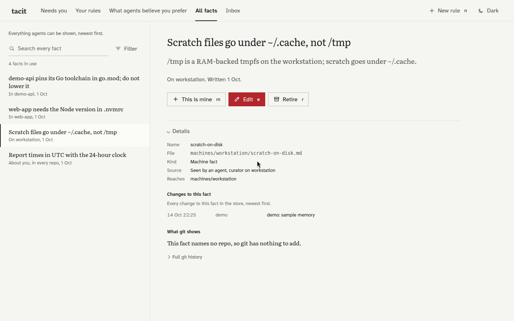

# tacit

**Memory for coding agents, with the evidence to keep it honest.**

[](https://github.com/agent-sh/tacit/actions/workflows/ci.yml)
[](https://github.com/agent-sh/tacit/actions/workflows/agnix.yml)
[](https://github.com/agent-sh/tacit/releases/latest)
[](LICENSE)

A decision made in one session should survive into the next. Tacit keeps project decisions, past mistakes and machine facts in a git repository, then gives your agents a small set of facts matched to the repo and prompt.

Run a local store on your laptop, or share one across machines. Works with **Claude Code, Codex, Hermes, Grok, pi, Muse and agy** on **Linux, macOS and Windows**.

- **Files you own.** One fact per Markdown file, with its source, scope and git history.
- **Context that fits.** Local full-text search and small context blocks. Hooks avoid repeating facts within a session.
- **Decisions with proof.** Your own words and recorded review decisions establish your rulings. Agents leave changes to those rulings for you.

## Quick start

Install git 2.29+, then use a [prebuilt release](https://github.com/agent-sh/tacit/releases/latest). Each archive includes the CLI, browser app and compatible scrump redactor. No Go or Rust build is needed. Model jobs need a supported agent CLI and its own provider setup. Search, owner edits and review work without a model account.

### Linux or macOS

```sh
curl -fLsS https://github.com/agent-sh/tacit/releases/latest/download/install.sh -o tacit-install.sh
sh tacit-install.sh
export PATH="$HOME/.local/bin:$PATH"
tacit init
tacit app --browser
```

### Windows

```powershell
Invoke-WebRequest -UseBasicParsing https://github.com/agent-sh/tacit/releases/latest/download/install.ps1 -OutFile tacit-install.ps1
powershell -NoProfile -ExecutionPolicy Bypass -File .\tacit-install.ps1
$env:PATH = "$env:LOCALAPPDATA\tacit\bin;$env:PATH"
tacit init
tacit app --browser
```

The installers select amd64 or arm64, verify the archive checksum and test the bundled redactor before replacing executables. They install into your account and leave PATH changes to you. For a specific release or another directory, use `sh tacit-install.sh --version v0.1.0 --bin-dir PATH`, or `-Version v0.1.0 -BinDir PATH` in PowerShell. Git and model CLIs remain separate dependencies. [Source builds](docs/portable.md#source-builds) are also available.

`init` creates a local store. It needs no server, tailnet or enrollment keys. Open the app to add your own rulings, inspect facts and review changes.

Choose the integration for your agent:

| Agent | Install | Connection |
|---|---|---|
| Claude Code | `tacit install claude` | Session-start and prompt hooks, and the MCP tools (`--no-mcp`: hooks only) |
| Codex | `tacit install codex` | Hooks; trust them once in `/hooks` |
| Hermes | `tacit install hermes` | Memory provider; follow the printed configuration steps |
| Grok / pi / Muse | `tacit install grok` / `pi` / `muse` | Prints the MCP configuration |
| agy | `tacit install agy` | Prints the MCP registration command |

<picture>
  <source media="(prefers-color-scheme: dark)" srcset="docs/images/app-dark.png">
  
</picture>

*The browser app, using the public example store. [Screenshot setup](docs/images/README.md).*

### One note, from a mistake to the next session

Record a failure and its fix. This example adds a sample note to your current local store:

```sh
tacit add --harness codex --kind observed --type past_mistake \
  --scope projects/demo-api --desc 'Run one database migration worker at a time' \
  --body 'Parallel migration workers contend for the database lock. Run one migration worker at a time.' migration-lock

tacit search --repo demo-api --inbox 'migration worker'
tacit app --browser
```

Open **Inbox** to inspect the note and its source. After curation, installed integrations can retrieve the reviewed fact in later sessions. `search --inbox` lets you inspect the note immediately. The `codex` source label records who wrote the note and does not require running a model for this example.

[Portable setup](docs/portable.md) covers dependencies, native jobs, build archives and platform validation. To exchange facts between machines, follow the [shared-store setup](docs/setup.md#install-the-shared-store).

## How it works

1. **Collect.** Agents write short inbox notes. Imports bring in existing memory files. An optional dreamer extracts candidates from redacted transcript deltas. It saves each successful window before the next call and recovers pending notes after interrupted runs.
2. **Curate.** Notes become individual facts with sources and scopes. Contradictions and uncertain changes become review items.
3. **Deliver.** A local SQLite FTS5 index matches facts to the repo, host and prompt. Hooks supply up to 10 facts at session start and 3 curated facts per prompt, with a separate match for a computed fact. Explicit search can return the full text.
4. **Check.** A verifier reads code, git, docs and permitted machine sources. It records evidence for its decisions and leaves unresolved questions for you.

Git also supplies hot spots, module maps, committed measurements and deletion-based staleness checks. Those steps need no model. The app brings facts, sources, history and review decisions together.

New local stores require evidence for owner rulings. Existing and server-created stores switch to that definition with the [ruling audit](docs/setup.md#initialize-ruling-proof).

The [methods guide](docs/methods.md) explains the ranker, curation, ruling proof and verification. The [store contract](SPEC.md) defines the file format and write rules.

### Architecture

The Go client holds the git store and search index locally. Hooks and MCP read from that local copy. Model jobs run through your selected agent CLI on the machine you configure for them. The dreamer, curator, conflict judge and verifier can each use a different runner.

For shared stores, a small Elixir server adds git transport, signed writer identities and a change feed. Writers add notes to their own inboxes; the curator writes the rest of the store. Clients fetch changes and rebuild their local indexes. The server holds no model credentials.

## Configuration

Keep operator settings in an untracked file. The repository ignores `config/local.yaml`; [config/example.yaml](config/example.yaml) contains generic values:

```sh
cp config/example.yaml config/local.yaml
chmod 600 config/local.yaml
export TACIT_SETTINGS="$PWD/config/local.yaml"
tacit init
```

Or use `tacit --config /absolute/path/config/local.yaml <command>`. On Windows, copy the example with `Copy-Item` and set `$env:TACIT_SETTINGS` to its absolute path. An explicit config selection is carried into installed hooks, MCP commands and jobs.

Without an override, Tacit reads `~/.config/tacit/config.yaml` on Linux/macOS or `%APPDATA%\tacit\config.yaml` on Windows. A user-config symlink can point to the ignored repository file so it loads from any working directory. Relative paths resolve against the actual settings file, including a symlink's target. A dangling config link is an error. Tacit loads only the selected file; it does not search other project checkouts for settings.

Precedence: command flags, then environment values (including a job's `--env-file`), then YAML, then generic defaults. Unknown fields and missing explicitly selected files fail before model work. Hooks with bad settings fail open without output. Store provider credentials in the selected CLI or the job env file.

### Which facts reach each prompt (optional)

By default a lexical score decides which matching facts a prompt sees, with no model call, and that is what we recommend: in live agent sessions a model selector did no better (eval/VALUE.md, "The prompt selector in live sessions"). Optionally a model judges each candidate: does it add something useful for this request, beyond topic overlap? Of the models we measured for that, **Jev** (TypeSafe, hosted) was the most accurate and fastest. To keep data in your AWS account, **Amazon Nova Micro on Bedrock** never picked a wrong fact in our runs, but it kept fewer useful ones. Any System One-compatible server, Bedrock model or OpenAI-compatible endpoint can be plugged in:

```yaml
utility:
  provider: jev            # or: bedrock, systemone, openai
  key_file: ~/.config/tacit/typesafe.env
```

Code still decides scope and limits first, and a failed or slow model falls back to the lexical selection. Setup for every provider, the thresholds and the full benchmark: [Choosing what each prompt sees](docs/selectors.md).

### Client settings

Every YAML option is listed here:

| Option | Environment equivalent | Meaning / default |
|---|---|---|
| `store` | `TACIT_STORE` | Git store; `~/.local/share/tacit/store` |
| `projects` | `TACIT_PROJECTS` | Checkouts root; `~/projects` |
| `index` | `TACIT_INDEX` | Local search index; `~/.local/state/tacit/index` |
| `keys` | `TACIT_CONFIG` | Writer-key directory; `~/.config/tacit` |
| `local_overlay` | `TACIT_LOCAL` | Local notes for a read-only clone; `~/.local/share/tacit/local` |
| `owner_names` | `TACIT_OWNER_NAMES` | Owner name aliases; YAML list, comma-separated environment value |
| `verify_roots` | `TACIT_VERIFY_ROOTS` | Extra permitted source directories; YAML list, `PATH` separator in environment; every directory must exist |
| `runner` | `TACIT_RUNNER` | Default CLI for all model jobs; `claude` |
| `runners` | `TACIT_<ROLE>_RUNNER` | Per-role CLI overrides |
| `models` | `TACIT_<ROLE>_MODEL` | Per-role model IDs accepted by the CLI; Claude aliases `opus` for dream, curate and verify, `haiku` for judge |
| `models.verify_fallback` | `TACIT_VERIFY_FALLBACK_MODEL` | Legacy same-runner verifier fallback; an empty environment value disables it |
| `efforts` | `TACIT_<ROLE>_EFFORT` | Per-role reasoning effort; omitted uses the CLI default, empty clears an override |
| `profiles` | `TACIT_<ROLE>_PROFILE` | Per-role Codex profile name; empty clears it |
| `dream_max_runtime` | `TACIT_DREAM_MAX_RUNTIME` | Extraction batch runtime; default `45m`, `0` disables the batch limit; `dream --max-runtime` wins |
| `timeouts` | `TACIT_<ROLE>_TIMEOUT` | Positive Go duration per model attempt, such as `10m`; default `20m` |
| `commands` | `TACIT_<TOOL>_COMMAND` | Executable name or path; default is the tool name |
| `runner_args` | `TACIT_<TOOL>_ARGS` | Extra argv without a shell; YAML list or JSON array in the environment |
| `fallbacks` | `TACIT_<ROLE>_FALLBACK` | One fallback route per role; JSON object in environment, `null` disables it |

`<ROLE>` is `curate`, `judge`, `dream` or `verify` (uppercase in environment names). `<TOOL>` is `claude`, `codex`, `hermes`, `grok`, `pi`, `muse` or `agy`. An explicit non-Claude runner uses its own model when no model is set. Per-role effort/profile options take precedence over general runner arguments. Accepted effort values are `none`, `minimal`, `low`, `medium`, `high`, `xhigh`, `max` and `ultra`, subject to the selected CLI/model. Effort adapters exist for Claude, Codex, Grok, Muse and pi; use `runner_args` for other tools.

A fallback route has these fields:

| Field | Meaning |
|---|---|
| `runner` | Required supported CLI name |
| `model` | Model ID; omitted uses that CLI's default |
| `effort` | Optional reasoning effort |
| `profile` | Optional Codex profile name |

The generic verifier fallback is Claude `sonnet`; other roles have none. An explicit runner or model selection disables that generic fallback unless one is configured. An explicit `TACIT_<ROLE>_FALLBACK` route wins over the legacy `TACIT_<ROLE>_FALLBACK_MODEL` override. Fallbacks run once for provider capacity, temporary service failures, expired authentication, a missing runner or an attempt deadline. Provider status and error codes decide whether to retry. They never start another fallback. Refusals, access denial and malformed output stop the job.

For example, users can choose different runners without publishing their settings:

```yaml
runner: claude
runners:
  dream: muse
models:
  dream: your-model-id
commands:
  muse: ./bin/muse
fallbacks:
  dream:
    runner: claude
    model: haiku
```

Check a setup without sending model requests:

```sh
tacit doctor
tacit doctor --models
tacit doctor --role dream --json
```

`doctor` checks Git 2.29+, scrump's text masking canary, effective role arguments, attempt timeouts and Codex profiles. It checks primary and fallback executables with `--version`. Missing runners are warnings for a memory-only installation. `--models` requires every configured runner; `--role` requires only that role and its fallback. `--json` prints check records. Exit 0 means the requested offline checks passed, 1 means a check failed, and 2 means invalid command options or settings. Provider credentials, model availability and live completions need a separate live test. Grok preflight also checks the provider settings and native file references needed by its isolated runtime.

Malformed extraction or incomplete judge answers leave the batch pending. Every conflict verdict is validated before any fact is retired. A fresh installation can curate observations without Claude or Codex owner history. Unbacked owner notes stay pending; owner rulings still require proof.

Grok jobs use a fresh runtime home for every request. Provider/model settings come from `GROK_HOME` (default `~/.grok`); native sign-in and requirements files are referenced without copying credentials. User hooks, plugins, memory and MCP servers stay outside the job. Managed defaults and mandatory policy hooks are retained. Provider keys and headers in copied settings must use environment references or native auth. On Windows, file references use hard links when symlinks are unavailable; put the job cache and Grok home on the same filesystem in that case.

Local job logs record each model attempt's role, route, fallback status, input tokens and reported cost. A batch reaching its runtime or call limit pauses successfully and resumes pending windows next run. Attempt deadlines and genuine model, redaction or persistence errors still fail. Accounting records `pause_reason` and `remaining_windows`.

A `null` cost means the runner did not report it; zero means a reported zero. Summaries label incomplete totals as reported cost. Logs contain no prompts or model answers in these accounting records.

`~` expands to the current home directory. Windows paths can use forward slashes or single-quoted YAML strings. Command paths containing a directory separator resolve against the config file; bare command names use `PATH`. A CLI `--model` option overrides the configured model. `tacit --runner TOOL` overrides all role runners for that invocation.

### Other environment settings

| Variable | Meaning / default |
|---|---|
| `TACIT_SETTINGS` | Select the YAML file; same as `--config FILE` |
| `TACIT_FOLLOW_STATE` | Follower heartbeat file; `~/.local/state/tacit/follow.json` |
| `TACIT_DERIVE_CONFIG` | Separate derive YAML; `~/.config/tacit/derive.yaml` |
| `TACIT_WRITER` | Writer identity used to sign a shared-store push |
| `TACIT_SERVER` | Server URL for `scripts/mac-setup.sh` |
| `TACIT_ENROLL_SSH` | SSH enrollment target for `scripts/mac-setup.sh` |
| `TACIT_REPO` | Code checkout used by `scripts/mac-setup.sh`; script's checkout by default |
| `TACIT_BIN` | Hermes integration executable override; installer-captured path by default |
| `TACIT_MODEL_JOB` | Internal recursion guard; Tacit sets it for model subprocesses |

The separate derive file accepts `branches` (repo-to-branch map) and `ordinary_names` (repo names that need explicit evidence because they are common words). Command-specific options, including job `--env-file`, are in the [client reference](docs/client.md). Provider variables belong to the selected CLI and can be supplied through the private job env file.

### Optional server environment

The server reads its own settings at startup:

| Variable | Meaning / default |
|---|---|
| `TACIT_DATA` | State root; `$XDG_STATE_HOME/tacit-server` or `~/.local/state/tacit-server` |
| `TACIT_BIND` | Bind IP; tailnet IPv4 when available, otherwise `127.0.0.1` |
| `TACIT_PORT` | Git/API port; `7447` |
| `TACIT_TAILSCALED` | Tailscale LocalAPI socket; `/var/run/tailscale/tailscaled.sock` |
| `TACIT_WHOIS` | Identity lookup; `localapi`, or `static:<ip>=<login>,...` for tests |
| `TACIT_ALLOW_LOOPBACK` | `1` permits loopback in the tailnet check; testing only |
| `TACIT_PUBLIC_PORT` | Optional reader-only listener on `127.0.0.1`; disabled when unset |

For background work, `tacit install dream` and `tacit install curate` write native job files and print start commands. Select the private config and provide the job environment before starting them. See [portable job setup](docs/portable.md#linux-and-macos).

## What we measured

The initial evaluation uses one owner's private store and Claude Code/Codex sessions. Results cover that workload; the original data is private. The scripts and methods are available to run on your own data.

Those measurements shaped the client: lexical retrieval beat the dense variants tested, splitting notes into individual facts improved delivery, and larger context blocks cost more without helping. The verifier remains limited: in the held-out sample it agreed with the owner on 3 of 13 findings and missed 8 of 10 retirements. Human review remains part of the method.

[Full measurements](eval/VALUE.md) · [Grep baseline](eval/BASELINE.md) · [Run the synthetic sample](eval/README.md#run-the-sample)

The synthetic sample runs without a server or model account. It demonstrates the formats and scoring. Long-session outcomes and delivery in other harnesses have not been measured.

## Security model

Agent writes and model digests pass through scrump before storage or a model call. A failed redaction stops the write. Local commits and shared pushes also check for known token shapes.

Local mode uses your OS account for access. Shared mode adds tailnet identity, signed keys and per-writer inbox enforcement. An optional public listener accepts signed readers only.

Model jobs send redacted digests and fact excerpts to the provider configured in the selected CLI. The verifier can read permitted source files. Choose the provider with that access in mind.

[Security policy and private reporting](SECURITY.md) · [Shared-store details](server/README.md)

## Documentation

| Guide | Covers |
|---|---|
| [Local and portable setup](docs/portable.md) | Configuration, dependencies, native jobs and validation |
| [Shared-store setup](docs/setup.md) | Server deployment, keys, machine roles and job configuration |
| [Client reference](docs/client.md) | Commands, flags, hooks and the app |
| [Methods](docs/methods.md) | How facts are collected, delivered and checked |
| [Choosing what each prompt sees](docs/selectors.md) | The optional model selector: Jev, Bedrock, any System One or OpenAI-compatible model, and the benchmark |
| [Evaluation](eval/README.md) | Scripts, samples and how to measure another store |
| [Contributing](CONTRIBUTING.md) | Development, tests and pull requests |

Agent configurations are checked in CI with [agnix](https://github.com/agent-sh/agnix), including the hooks and MCP settings generated by the client.

## License

[Apache 2.0](LICENSE). Bundled fonts use the SIL Open Font License 1.1; see [NOTICE](NOTICE).
